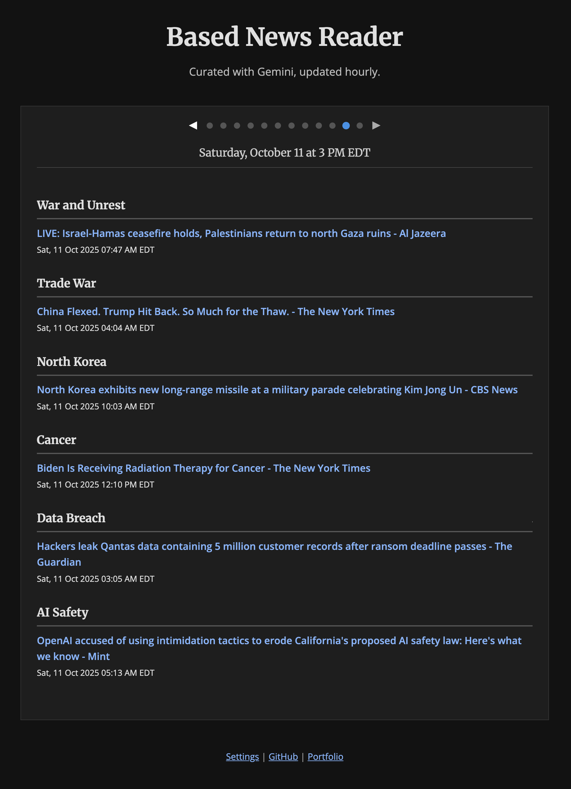

# Based News Reader

This project is a fully automated news digest web app. It fetches headlines from Google News, uses Google's Gemini AI to intelligently select and rank them based on user preferences, and serves the content from a live database.

The entire process is hosted on Railway, with scheduled workers that update the news hourly and maintain database storage weekly.

View the demo: **[news.blakerayvid.com](https://news.blakerayvid.com)**

---

## Key Features

*   **Configurable via Google Sheets:** Easily manage topics, keywords, banned terms, and application parameters by copying and editing a [Google Sheet](https://docs.google.com/spreadsheets/d/1OjpsQEnrNwcXEWYuPskGRA5Jf-U8e_x0x3j2CKJualg/edit?usp=sharing).
*   **Intelligent Curation with Gemini:** A carefully engineered prompt instructs the Gemini AI to perform aggressive cross-topic deduplication, filter out low-quality content, and prioritize headlines based on user-defined weights.
*   **Dynamic Web App:**
    *   The backend is a lightweight Flask web server that queries a PostgreSQL database.
    *   Server-side rendering ensures fast load times, while historical data is lazy-loaded on demand.
*   **Automated Workers & Database Maintenance:**
    *   `digest/digest.py`: Runs hourly to fetch, curate, and store fresh news digests.
    *   `digest/prune_db.py`: Runs weekly on a cron schedule to prune historical digests and articles older than the retention threshold (default 60 days) and clean up orphaned digests.
*   **Interactive Frontend:**
    *   Pure HTML, CSS, and vanilla JavaScript (dependency-free).
    *   Includes swipeable carousels for browsing past digests.
    *   **Single-topic mode:** Click on any topic heading to view chronological updates filtered specifically for that topic. This drills down into a single, scrollable page displaying the 10 most recent days of headlines, grouped chronologically by day headers with the newest headlines at the top.
    *   **Accessible Navigation:** Supports keyboard controls (`ArrowLeft` / `ArrowRight` to transition digests, `Escape` to close topic views), pointer hovers, and clean hierarchical heading layouts.

## Tech Stack

*   **Backend:** Python 3, Flask
*   **AI & ML:** 
    *   Google Gemini API (`gemini-2.5-flash-lite` via `google-genai`)
    *   `nltk`
*   **Database:** PostgreSQL
*   **Frontend:** HTML5, CSS3, Vanilla JavaScript, Jinja2, `Chart.js`
*   **Hosting & Automation:** Railway (Web Service + Hourly Digest Cron + Weekly Database Pruner Cron)

---

## Directory Structure

```plaintext
based-news/
├── README.md                   # This file
├── web/
│   ├── app.py                  # Flask web server
│   ├── railway.json            # Railway deployment configuration
│   ├── requirements.txt        # Python dependencies for the web server
│   ├── static/                 
│   │   └── favicon.ico         
│   └── templates/
│       └── index.html          # Template for the news digest
└── digest/
    ├── digest.py               # Worker script for fetching/curating news
    ├── prune_db.py             # Maintenance script to prune expired records from PostgreSQL
    ├── Dockerfile              # Container configuration for Railway worker & cron services
    ├── Procfile                # Defines processes for hosting
    └── requirements.txt        # Python dependencies for the digest and prune workers    
```

---

## Local Development

### 1. General Setup
1. **Clone** your repository:
   ```bash
   git clone <your-repository-url>
   cd based-news
   ```

---

### 2. Run the Background Worker & Pruner (Digest Context)
The background curation script, database pruner, and dependencies are managed within the `digest/` subdirectory.
1. **Navigate** into the digest directory:
   ```bash
   cd digest
   ```
2. Create and activate a virtual environment inside the `digest/` directory:
   ```bash
   python3 -m venv .venv
   source .venv/bin/activate  # On Windows: source .venv/Scripts/activate
   ```
3. Install the dependencies:
   ```bash
   pip install -r requirements.txt
   ```
4. **Create a `.env` file** inside the `digest/` folder:
   ```env
   DATABASE_URL=your_postgresql_database_url
   GEMINI_API_KEY=your_google_gemini_api_key
   RETENTION_DAYS=60
   ```
5. **Run the news digest worker script:**
   ```bash
   python digest.py
   ```
6. **Run the database maintenance script (optional dry run / prune):**
   ```bash
   # Prunes records older than RETENTION_DAYS (defaults to 60 days)
   python prune_db.py
   ```

---

### 3. Run the Web Server (Web Context)
The Flask web interface is managed within the `web/` subdirectory and uses its own virtual environment.
1. **Navigate** into the web directory (from the project root):
   ```bash
   cd ../web
   ```
2. Create and activate a separate virtual environment inside the `web/` directory:
   ```bash
   python3 -m venv .venv
   source .venv/bin/activate  # On Windows: source .venv/Scripts/activate
   ```
3. Install the web service dependencies:
   ```bash
   pip install -r requirements.txt
   ```
4. **Create a `.env` file** inside the `web/` folder:
   ```env
   DATABASE_URL=your_postgresql_database_url
   ```
5. Run the web server:
   ```bash
   flask run
   ```
6. Open your browser and navigate to `http://localhost:5000`.

---

## Railway Deployment & Cron Services

The project uses three separate services on Railway connected to the same repository:

1. **Web Service (`web/`):** Hosts the public Flask web server (`gunicorn app:app`).
2. **Digest Worker (`digest/`):**
   * **Root Directory:** `digest`
   * **Custom Start Command:** `python digest.py`
   * **Cron Schedule:** `0 * * * *` (Hourly)
3. **Database Pruner (`digest/`):**
   * **Root Directory:** `digest`
   * **Custom Start Command:** `python prune_db.py`
   * **Cron Schedule:** `0 17 * * 5` (Every Friday at 5:00 PM UTC)
   * **Variables:** `DATABASE_URL` linked to your Railway PostgreSQL service via `${{Postgres.DATABASE_URL}}`

---

<br>



---
<p align="center">&copy; 2026 <a href="https://blakerayvid.com">Blake Rayvid</a>. All rights reserved.</p>